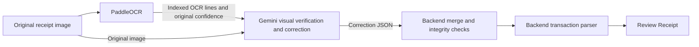

# PaddleOCR + Gemini vision correction plan

Date: 3 October 2026. Revision: Gemini owns visual correctness; backend performs
merge and integrity checks. Status: implemented and deployed to local Docker Desktop.

Validation: 45 receipt tests and mobile TypeScript passed; five public scans matched
merchant/date/total, with three partial line-verification responses. See
`../../evaluation-results/receipt-vision-2026-10-02/combined-report-2026-10-03.md`
for deployment evidence, preserved first-run failures and evaluation limitations.

## Intended behavior

PaddleOCR extracts receipt text. Gemini 3.5 Flash-Lite is responsible for judging
what the image visibly shows: confirming correct OCR, correcting wrong text,
recovering missed readable text and identifying unreadable portions. The backend
accepts structurally usable Gemini corrections, merges them with the original
lines, and preserves provenance. It does not independently judge the image or
veto a Gemini correction because PaddleOCR reported high character confidence.
The receipt parser then extracts transaction fields from the merged text.
Gemini's response contains OCR correction data, not the final merchant/date/total
transaction object.



Gemini receives receipt images and OCR text through Google's Gemini API using
the server-side key. Deployment target is this PC's Docker Desktop context
`desktop-linux`. Oracle VPS deployment is excluded from this plan.

## Responsibility boundaries

| Component | Responsibility |
|---|---|
| PaddleOCR | First-pass extraction, line order and original confidence |
| Gemini vision | Judge visual text correctness, correct errors, recover missed text and mark uncertainty |
| Backend merge | Check response usability and references; preserve originalText, produce finalText and record correction metadata |
| Receipt parser | Interpret merged text as merchant, date, items and payable total; validate transaction formats |
| User | Confirm the transaction before saving |

Original PaddleOCR confidence is diagnostic information, not a veto over Gemini.
For example, a source line with confidence 0.96 can still be corrected from
`TOTAL RM 6O.OO` to `TOTAL RM 60.00` when Gemini reads that amount in the image.
Do not reject corrections merely because a source score exceeds 0.90 or because
a corrected value differs from the initial parser result. Low source confidence
alone also does not invalidate a Gemini-confirmed reading.

This assigns visual responsibility to Gemini; it does not establish that Gemini
is infallible or its self-reported confidence is calibrated. Final user review
and backend format checks remain. Google's structured-output guidance also
requires application validation of values, even with syntactically valid JSON:
https://ai.google.dev/gemini-api/docs/structured-output

## Pre-implementation baseline

- `app/receipt_ocr.py` currently runs PaddleOCR, parses its lines, and then calls
  `enhance_receipt_text(raw_text)` to replace structured transaction fields.
- `app/receipt_cleanup.py` currently sends OCR text through the coaching provider
  chain. It does not send the receipt image.
- The local Docker Desktop container loads `gemini-3.5-flash-lite`, but changing
  that setting did not implement image verification.
- The prior five-image Gemini benchmark tested direct field extraction from
  public scans. It did not test this correction-then-parser architecture.
- The current date parser accepts numeric dates only. Correcting characters
  alone also will not resolve every semantic merchant ambiguity, such as a
  customer name above a business heading.

## 1. Preserve PaddleOCR output

Keep reconstructed line order, stable line IDs and original confidence scores.
Preserve original lines for comparison and fallback. Send the original uploaded
image and indexed text to Gemini; do not ask it for replacement transaction
fields. Retain existing authentication, image-size checks and row reconstruction.
Empty OCR can still be checked against the image, with recovered text identified
as Gemini-added text rather than assigned a PaddleOCR confidence score.

## 2. Define Gemini's correction contract

Use a bounded JSON Schema response containing:

- `confirmedLineIds`: source lines checked and found consistent with the image.
- `corrections`: source line ID, corrected text and a short reason.
- `uncertainLineIds`: source lines that cannot be reliably checked.
- `missingLines`: visibly readable text missed by OCR, with an insertion anchor
  referring to an existing line; a document-start anchor is also permitted.

Illustrative response for an input containing source line IDs 0 and 1:

```json
{
  "confirmedLineIds": [0],
  "corrections": [
    {
      "lineId": 1,
      "correctedText": "TOTAL RM 97.00",
      "reason": "The amount is visibly 97.00."
    }
  ],
  "uncertainLineIds": [],
  "missingLines": []
}
```

Preserve printed wording and layout order, change only image-supported errors,
and mark unreadable content. Do not invent text, rewrite receipts into summaries,
convert subtotal into final total, or delete customer names to influence the
parser. Receipt contents are data, not instructions. Unmentioned lines are not
automatically confirmed.

Use one bounded request with no automatic retries or additional coaching-provider
cleanup call. Keep credentials server-side; routine logs must not contain receipt
text, images or keys.

## 3. Backend merge and integrity checks

Check only what the backend can establish without judging the image: decodable
JSON, usable record types, bounded sizes, existing source IDs, contradictory
records and insertion anchors. Do not add confidence thresholds, receipt-specific
value allowlists, visual re-evaluation or rules that reject a well-formed correction
because the original text seemed plausible. Transaction date/money checks belong
to the parser and do not rewrite Gemini's observed text.

Handle response defects locally where possible:

| Condition | Merge behavior |
|---|---|
| Usable confirmed or corrected record | Accept Gemini's decision; apply correctedText when supplied |
| Original line omitted from Gemini response | Preserve originalText; status unverified |
| Gemini marks a line uncertain | Preserve originalText; status uncertain |
| Unknown source ID or malformed record | Skip that record; retain all existing source lines |
| Identical repeated decision | Deduplicate it |
| Conflicting decisions for the same source ID | Preserve that original line; mark unverified; retain other usable records |
| Missed text with a valid insertion anchor | Insert Gemini's text at the declared location; mark source as Gemini-added |
| Missed text without a usable anchor | Do not place it arbitrarily; retain its metadata as unapplied |
| Undecodable/truncated JSON or unusable overall response | Use unchanged PaddleOCR output and mark verification failed |

Completeness is a coverage measure, not a reason to discard every usable correction.
Expose partial verification when some source lines remain unverified. Never delete
an original line merely because the model omitted it. Valid JSON with omitted
records can be merged partially; an undecodable truncated response cannot.

Produce a separate ordered collection containing each line's `originalText`,
`finalText`, original OCR confidence, verification status, source ID and correction
reason. Corrected/added text does not receive a fabricated confidence score.
Insert missed text at its declared position so items remain above the totals
block. The parser consumes finalText in that order; original lines and unapplied
records remain available as provenance.

## 4. Parse transaction fields in the backend

Run the transaction parser on merged lines to produce merchant, purchase date,
payable total and items. Keep category classification after final parsing, using
the resulting merchant/items.

Required general parser improvements:

- Accept numeric and named-month dates and validate calendar dates.
- Prefer identifiable business headings over invoice, cashier or customer
  metadata; flag ambiguous merchant candidates.
- Distinguish final payable total from subtotal, tax, rounding, tender and change,
  preserving existing English/Malay label support and item boundaries.
- Validate monetary values and item structure before returning the draft.

Text correction and field interpretation are separate. Correct spelling does not
establish that the parser selected the correct semantic field.

## 5. Review and fallback behavior

Preserve existing response fields for the Review Receipt screen. Keep `rawLines`
as original OCR text and add optional correction/verification metadata. Use
`reviewRequired` and `reviewWarnings` for changed or uncertain content without
adding a processor badge.

Distinguish model-reported verification, backend validation and user confirmation.
Do not label every financial field correct merely because JSON passed validation
or Gemini confirmed its source text.

Use Gemini's confirmed/corrected/uncertain decision for visual verification status.
Do not automatically flag an image-confirmed line as inaccurate solely because
PaddleOCR's original score was low. Keep source confidence separately for diagnosis.
User-facing warnings should focus on changed critical transaction values,
unreadable or unverified lines affecting those values, ambiguous parser choices
and unavailable verification. Ordinary formatting/address corrections belong in
metadata rather than a warning for every line. The user still confirms the draft.

Missing key, timeout, quota exhaustion or unusable output: parse untouched
PaddleOCR lines, mark verification unavailable/failed, and keep the draft editable.
Do not label the fallback result verified.

## 6. Tests before deployment

1. Unchanged text, character corrections, uncertainty, missing lines, empty OCR
   and insertion order around totals.
2. Omitted source lines remain present and unverified while other valid changes
   apply. Unknown/malformed records are skipped, duplicate decisions deduplicated,
   and conflicts affect their own source lines rather than the whole result.
   Invalid/truncated JSON preserves the full fallback; invalid anchors never move
   text arbitrarily.
3. Numeric/named-month dates, ambiguous headings, item boundaries, tax/rounding,
   tender and change.
4. Original image plus OCR reaching Gemini, parser running after correction,
   preserved provenance/confidence and no extra provider request on failure.
5. High-confidence but incorrect PaddleOCR text is corrected by Gemini; source
   confidence and a differing initial parse do not block a usable correction.
   Low-confidence but Gemini-confirmed text retains its visual verification status.
6. Quota, timeout and missing-key fallback, plus existing authentication and
   upload checks.

Evaluate the combined pipeline on public receipts with expected text and fields
frozen before inference. Measure text correction quality separately from final
merchant/date/total/item accuracy; record transcription provenance, latency and
token usage. Also measure wrong Gemini corrections, uncertain/unverified coverage
and recovered missing text. Compare PaddleOCR-only parsing against corrected-text parsing.
Prior direct Gemini extraction scores are not evidence for this new pipeline.
Private test receipts require their authorization.

## 7. Docker Desktop deployment

After implementation approval and passing checks:

1. Verify `desktop-linux` resolves to Docker Desktop's local Windows named pipe.
2. Deploy only the local Compose backend, preserving model-cache volumes and
   server-side configuration. Restart to load bind-mounted application code.
3. Verify the loaded model, `/health`, `/ready`, and a public receipt through the
   actual deployed correction-then-parser path.
4. Report returned values and correction/fallback evidence separately from
   phone-camera or installed-app testing.

Oracle SSH/VPS deployment, database migrations and Android releases are excluded.
If a mobile contract change beyond optional metadata is needed, review its scope
and build requirements separately.
