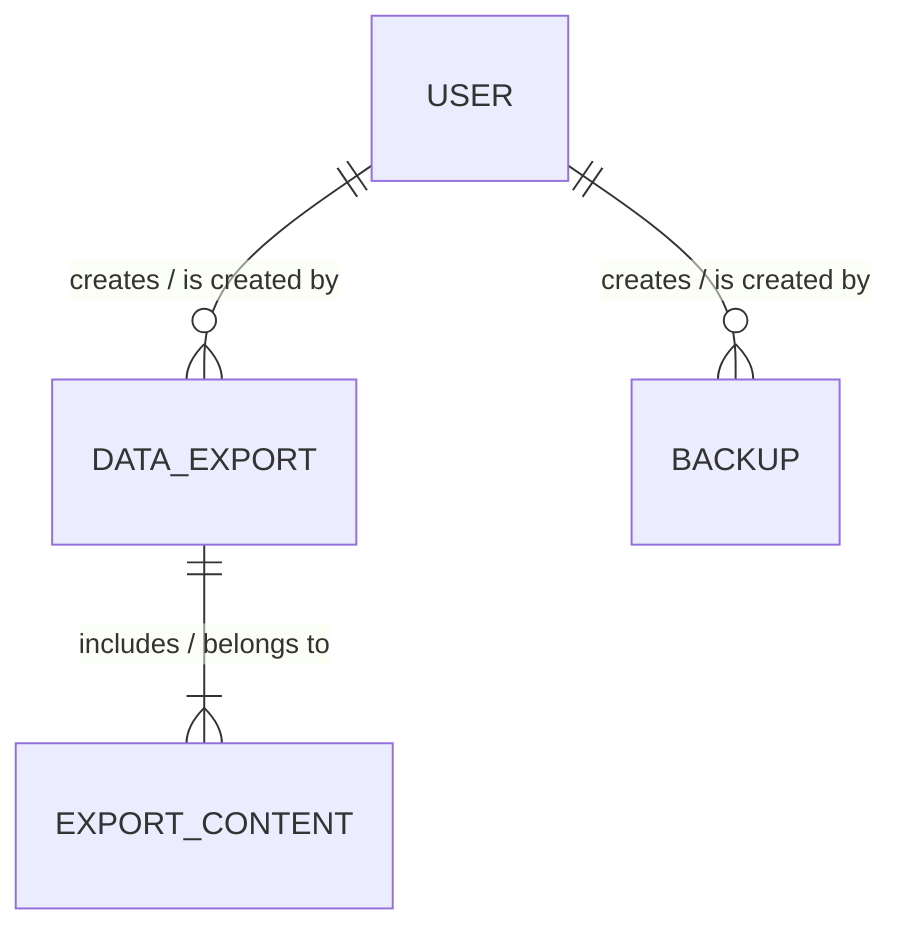

# Financial Data Export and Backup Design

Date: 2026-07-16

## Objective

Implement the FinCoach Financial Data Export and Backup module with real Expo file generation, private Supabase cloud backups, owner-scoped history, and safe full-data restoration. The module must follow the approved FinCoach UI and must not use mock files, mock backup rows, or simulated success states.

## Approved scope

The module provides:

- CSV and PDF export with an inclusive custom date range;
- selectable export sections for transactions, budgets, savings goals, and report summaries;
- real Android file sharing, saving, and PDF printing;
- manual cloud backup;
- automatic cloud backup at most once per 24 hours when the authenticated app opens or returns to the foreground;
- full FinCoach data snapshots;
- backup history, status, size, and deletion;
- checksum and schema-version validation before restore;
- atomic database restoration from a selected backup;
- export and backup activity records protected by Row-Level Security (RLS).

## Thesis, DFD, and UI alignment

The thesis defines Process 5.0 as a separate module that:

1. generates CSV or PDF files from a user-selected period and financial records;
2. packages financial data into a backup and saves its details;
3. retrieves a selected backup and reports the restore result;
4. updates restore or regeneration status;
5. deletes old backup records or exported-file records.

The approved UI contains:

- an `Export & Backup` entry under App Settings;
- CSV and PDF export actions;
- an export sheet with format, date range, and included-data controls;
- an export success screen;
- an auto-backup toggle;
- `Back up now`;
- a restore screen showing available backups and a destructive replacement warning.

The implementation preserves this structure and replaces all demo state with real application data and storage operations.

## Architecture decision

Use a hybrid mobile, Postgres, and private Storage architecture:

- The Expo client reads the authenticated user's financial records.
- Pure TypeScript functions create a versioned backup document and deterministic CSV or HTML export content.
- Expo FileSystem writes local files.
- Expo Print produces PDF files from escaped HTML.
- Expo Sharing opens Android's native share/save flow.
- Supabase Storage holds JSON backup objects in a private `financial-backups` bucket.
- `public.data_exports` stores each CSV/PDF export event.
- `public.export_contents` is the normalized child table for the sections selected in each export.
- `public.backups` stores each manual or automatic cloud backup and its latest restore state.
- `profiles.auto_backup_enabled` stores the user-level automatic-backup preference.
- A PostgreSQL restore function validates ownership and replaces restorable data in one database transaction.

Cloud backup objects and their metadata rows are coordinated with compensating cleanup. Database restoration is atomic; Storage upload and database metadata insertion cannot share a transaction.

## Alternatives rejected

### Store backup JSON directly in PostgreSQL

This simplifies restore lookup but duplicates potentially large user datasets inside the primary database and makes retention more expensive. It is not selected.

### Local-device backup only

This avoids Storage configuration but cannot recover data after device loss or reinstall and does not satisfy the approved cloud-backup UI. It is not selected.

### Server-generated exports and backups

This centralizes processing but adds an unnecessary FastAPI or Edge Function dependency for the current data volume. It is not selected because authenticated Supabase reads, Expo file APIs, and a tightly scoped restore RPC are sufficient.

## Module boundaries

This module may read data produced by Profile, Transaction, Budget, Savings, Reports, and Alerts modules. It does not own their business rules and does not mutate their records except through the explicit restore operation.

The module does not add:

- AI Financial Coaching;
- new LLM, RAG, embedding, or FastAPI calls;
- bank integration;
- receipt OCR;
- remote duplication of receipt images;
- whole-project or Supabase platform disaster recovery.

Existing AI-generated report text, if stored by another module in the future, may be exported as ordinary report content. This module does not generate AI insight.

## Backup scope

Backup schema version `1` contains:

- `profiles`: the authenticated user's financial profile;
- `categories`: user-owned custom categories only;
- `transactions`;
- `monthly_budgets`;
- `budgets` category limits;
- `savings_goals`;
- `savings_contributions` belonging to the backed-up goals;
- `reports`;
- `notification_preferences`;
- `reminders`;
- `alerts`.

System default categories are not copied because they are shared reference data. Transactions referencing system categories retain their category IDs. Receipt images are not duplicated; `receipt_image_path` remains in each transaction so the existing secured receipt object can still be referenced.

The snapshot excludes:

- authentication credentials and Supabase `auth.users`;
- export and backup records;
- `profiles.auto_backup_enabled`;
- device push tokens and delivery attempts;
- Storage objects other than the JSON backup itself;
- temporary files and application cache.

## Backup document

The canonical JSON document has this shape:

```ts
type FinancialBackupDocumentV1 = {
  schemaVersion: 1;
  createdAt: string;
  userId: string;
  appVersion: string;
  data: {
    profile: Profile | null;
    customCategories: Category[];
    transactions: Transaction[];
    monthlyBudgets: MonthlyBudget[];
    categoryLimits: CategoryLimit[];
    savingsGoals: SavingsGoal[];
    savingsContributions: SavingsContribution[];
    reports: Report[];
    notificationPreferences: NotificationPreferences | null;
    reminders: BillReminder[];
    alerts: AlertRecord[];
  };
};
```

Object keys and arrays are serialized deterministically. The client calculates a SHA-256 checksum over the exact UTF-8 JSON uploaded to Storage. The record stores the checksum, byte size, schema version, and object path.

Backup paths use:

```text
<user_id>/<manual|automatic>/<ISO timestamp>-<record_id>.json
```

## Database design

The logical ERD uses these relationships:



This resolves the repeating export-section group through `EXPORT_CONTENT`. There is no unresolved many-to-many relationship.

### `data_exports`

The table stores one row per CSV or PDF export:

```text
id uuid primary key
user_id uuid not null
format csv | pdf
status pending | processing | completed | failed
file_name text not null
file_size_bytes bigint nullable
date_from date nullable
date_to date nullable
completed_at timestamptz nullable
created_at timestamptz not null
```

Export rows have no Storage path because generated files remain local to the user's device or chosen share destination.

Indexes support:

- recent exports by `(user_id, created_at desc)`;
- period lookup by `(user_id, date_from, date_to)`.

### `export_contents`

The normalized child table stores one row for every section included in an export:

```text
export_id uuid not null
content_type transaction | budget | savings | report
primary key (export_id, content_type)
```

Every `EXPORT_CONTENT` row belongs to exactly one `DATA_EXPORT`. Every completed `DATA_EXPORT` contains one or more `EXPORT_CONTENT` rows. The composite identifier prevents the same content type from being repeated within one export.

### `backups`

The table stores one row per real cloud backup:

```text
id uuid primary key
user_id uuid not null
backup_type manual | automatic
status pending | processing | completed | failed
file_name text not null
storage_path text nullable
file_size_bytes bigint nullable
checksum_sha256 text nullable
schema_version integer not null
last_restore_status pending | processing | completed | failed nullable
last_restored_at timestamptz nullable
completed_at timestamptz nullable
created_at timestamptz not null
```

Restore is a process, not a separate entity in this FYP logical ERD. The selected backup row stores only its latest restore state. The system does not retain a history of every restore attempt.

Indexes support:

- backup history by `(user_id, created_at desc)`;
- automatic-backup eligibility by `(user_id, backup_type, status, completed_at desc)`.

### `profiles.auto_backup_enabled`

The existing `USER`/`profiles` record gains:

```text
auto_backup_enabled boolean not null default true
```

This is a user-level preference, not a separate multi-instance business entity.

### RLS and grants

- RLS is enabled on `data_exports`, `export_contents`, and `backups`.
- Authenticated users can select, insert, update, and delete their own `data_exports` and `backups` rows where `(select auth.uid()) = user_id`.
- `export_contents` policies verify ownership through the parent `data_exports` row.
- The existing profile policy protects `auto_backup_enabled`.
- Anonymous roles receive no table access.
- Storage policies restrict `financial-backups` objects to the bucket and first path segment equal to the authenticated user's ID.
- Storage `SELECT`, `INSERT`, `UPDATE`, and `DELETE` policies are explicit.
- The bucket is private and accepts only `application/json` objects up to 10 MiB.

## Export behavior

### Selection

The export sheet defaults to the current Malaysia-local calendar month and supports:

- current month;
- previous month;
- custom inclusive `YYYY-MM-DD` date range;
- CSV or PDF;
- transactions;
- budgets;
- savings goals;
- report summaries.

At least one section must be selected. Start date cannot be later than end date.

### CSV

CSV is UTF-8 with a byte-order mark for spreadsheet compatibility. Each selected section has its own heading and column header. Values follow RFC 4180 escaping rules for commas, quotes, carriage returns, and line feeds.

Transactions are bounded by the selected date range. Budgets are bounded to intersecting calendar months. Savings goals show current values because they are not period-ledger records. Report history is bounded by `generated_at`.

### PDF

PDF uses escaped HTML rendered through Expo Print. It includes:

- FinCoach title and generation timestamp;
- selected date range;
- income, expense, net, and transaction summary;
- selected detailed sections;
- page-friendly tables and MYR formatting;
- a footer stating that it is a user-generated personal financial report.

The implementation must escape all user-controlled text before inserting it into HTML.

### Local files

Generated files are written to an app cache export directory, then opened through Expo Sharing. Cached files may be overwritten or deleted by the operating system. The completed `data_exports` row remains as export history but is not presented as a guaranteed cloud-hosted copy.

## Backup creation flow

1. Create a `pending` backup record.
2. Mark it `processing`.
3. Fetch every required owner-scoped dataset.
4. Reject the backup if any required dataset fails to load; do not create a partial snapshot.
5. Build and serialize the versioned backup document.
6. Calculate SHA-256 and byte size.
7. Upload the exact JSON bytes to the private bucket.
8. Update the metadata row to `completed`.
9. For an automatic backup, delete older automatic backups beyond the five newest completed records, removing Storage objects through the Storage API before deleting metadata.
10. On failure, remove any newly uploaded object when possible and mark the record `failed`.

Manual backups are retained until the user deletes them. Automatic backups retain the latest five completed objects. Failed records may be displayed for diagnosis but contain no raw internal error details.

## Automatic backup behavior

`profiles.auto_backup_enabled` defaults to true.

The app checks eligibility:

- after authentication bootstrap;
- when the app returns to the foreground;
- only while a valid network-backed session exists.

An automatic backup runs only when no completed automatic backup exists within the previous 24 hours. A process-level lock prevents duplicate foreground events from creating concurrent backups. This is opportunistic scheduling, not guaranteed Android background execution.

## Restore behavior

### Client validation

Before the restore RPC is called, the client:

1. verifies the selected metadata row is a completed backup owned by the current user;
2. downloads the object using the authenticated Storage API;
3. verifies file size when available;
4. recomputes and compares SHA-256;
5. parses JSON;
6. requires schema version `1`;
7. requires the document `userId` to equal the authenticated user;
8. validates required collections and primitive field shapes.

If validation fails, no financial table is modified.

### Atomic database restore

`public.restore_financial_backup_v1(payload jsonb, backup_record_id uuid)`:

- requires an authenticated user;
- confirms the referenced completed `backups` row belongs to that user;
- validates `schemaVersion` and `userId` again;
- marks `last_restore_status` as `processing`;
- deletes the user's restorable rows in foreign-key-safe order;
- restores the profile with an upsert;
- restores user-owned categories while preserving backed-up IDs;
- restores parent rows before dependent transactions and contributions;
- restores notification preferences, reminders, alerts, and report history;
- resets affected identity sequences to at least the current maximum;
- marks `last_restore_status` as `completed` and sets `last_restored_at`;
- returns restored row counts.

The PostgreSQL function executes within one transaction. Any exception rolls back all financial-data mutations. After an RPC error, the owner-scoped client updates `last_restore_status` to `failed`. After success, the client fetches fresh application data and reports completion.

The restore operation replaces only the backed-up user-owned domain data. It does not delete authentication, default categories, receipt objects, device tokens, delivery-attempt audit rows, `auto_backup_enabled`, or backup history.

## Delete behavior

Deleting a completed cloud backup:

1. calls the Storage API to remove the object;
2. deletes the metadata row only after object deletion succeeds.

Deleting a failed backup or local export record deletes only its metadata row.

## Mobile components and routes

The module adds:

- `src/app/export-backup/index.tsx`: main Export & Backup screen;
- `src/app/export-backup/success.tsx`: completed export details and re-share action;
- `src/app/export-backup/restore.tsx`: real backup selection, deletion, validation, confirmation, and restore;
- `src/components/export-backup/export-sheet.tsx`: format, dates, and included sections;
- focused status, record-row, and confirmation components under the same feature folder.

`src/app/profile/settings.tsx` routes `Export & Backup` to the module instead of showing `Coming soon`. The root stack registers the three routes.

## Data and domain boundaries

### `src/lib/export-backup-domain.ts`

Pure functions handle:

- export selection validation;
- Malaysia-local period presets;
- CSV quoting and section generation;
- safe HTML generation;
- deterministic backup serialization;
- backup document structural validation;
- retention selection;
- file-name generation;
- user-safe error mapping.

### `src/lib/export-backup.ts`

The Supabase client boundary handles:

- export source retrieval;
- full backup source retrieval;
- `data_exports`, `export_contents`, and `backups` CRUD;
- profile backup-preference fetch/update;
- private Storage upload/download/delete;
- restore RPC invocation;
- recent export and backup-history queries.

### `src/lib/export-files.ts`

The Expo platform boundary handles:

- cache file writing;
- PDF creation;
- native share availability;
- sharing CSV and PDF files;
- cached export cleanup.

Keeping pure generation, Supabase I/O, and device I/O separate makes each behavior independently testable.

## Error handling

- Missing session: do not query or write anonymously.
- Invalid date or empty selection: show field-level validation before data loading.
- Partial source failure: fail the entire export or backup rather than create misleading content.
- File generation failure: mark the export failed and show a retry action.
- Sharing unavailable: retain the generated cache URI for the current session and explain that sharing is unavailable.
- Storage upload failure: mark the backup failed and remove any partial object when possible.
- Metadata completion failure after upload: attempt Storage cleanup and retain a failed record.
- Corrupt or modified backup: block restore before RPC execution.
- Restore RPC failure: database mutations roll back and the UI remains on the restore screen with a retryable error.
- Duplicate taps: disable active actions and enforce one in-flight backup or restore per screen.
- App termination during processing: `pending` or `processing` records older than 15 minutes are reconciled to `failed` on the next module load.

## Security and privacy

- No service-role key is added to the mobile app.
- Every table query includes an explicit owner filter even when RLS already applies.
- Backup objects use a private bucket and owner-folder policies.
- Signed public links are not generated for backup objects.
- Storage operations use the Supabase Storage API; SQL never directly deletes Storage metadata.
- Restore uses a narrowly scoped `SECURITY DEFINER` function with a fixed `search_path`, explicit authentication and ownership validation, and revoked public execution.
- Persisted errors never contain tokens, SQL text, raw payloads, or full Supabase responses.
- Backup JSON is not sent to AI, analytics, logging, or third-party services.
- The current design relies on Supabase's server-side Storage encryption and transport security; it does not claim client-side end-to-end encryption.

## Testing strategy

Implementation follows red-green-refactor.

### Domain tests

- current-month, previous-month, and custom-range resolution in `Asia/Kuala_Lumpur`;
- invalid date ranges and empty section selection;
- RFC 4180 CSV escaping and UTF-8 content;
- deterministic backup serialization;
- schema-version, owner, collection, and primitive validation;
- HTML escaping;
- backup filename and object-path generation;
- automatic-retention selection;
- user-safe error mapping.

### Data-client tests

- explicit owner filters on every source table;
- complete backup source collection and partial-failure rejection;
- export and backup state transitions;
- normalized export-content inserts and ownership;
- private Storage path and exact uploaded bytes;
- download and checksum inputs;
- profile preference update;
- recent-history ordering and limits;
- restore RPC payload and backup-record ID;
- Storage-first deletion behavior.

### Platform tests

- CSV cache file creation;
- PDF generation input and output URI;
- share availability and MIME type;
- error propagation from FileSystem, Print, and Sharing adapters.

### UI tests

- settings navigation replaces `Coming soon`;
- loading, empty, populated, failed, and refreshing states;
- export validation and duplicate-submit prevention;
- real completion details;
- auto-backup toggle persistence;
- manual-backup progress and result;
- restore selection, destructive confirmation, checksum failure, RPC failure, and success;
- backup deletion confirmation;
- absence of mock backup rows and mock success messages.

### Schema verification

- table fields, constraints, indexes, grants, and RLS;
- private bucket configuration and owner-folder Storage policies;
- user A cannot access user B metadata or objects;
- anonymous access is denied;
- restore rejects cross-user or non-completed backup records;
- restore rollback leaves all domain tables unchanged after a forced failure.

### Build and acceptance verification

- focused export and backup tests;
- complete mobile test suite;
- TypeScript typecheck;
- focused ESLint;
- Android production JavaScript export;
- Honor 200 manual test with real transactions, budgets, savings, reports, reminders, and a restore round trip.

## Acceptance criteria

- App Settings opens a working Export & Backup module.
- CSV and PDF exports contain real owner-scoped data for the selected period and sections.
- Generated files can be saved or shared using Android's native flow.
- Manual backup creates a real private Storage object and completed metadata record.
- Auto-backup preference persists and eligibility is limited to once per 24 hours.
- Only the latest five completed automatic backups are retained.
- Manual backups remain until explicitly deleted.
- Restore rejects corrupt, incompatible, or cross-user documents before mutation.
- A successful restore replaces all approved FinCoach domain data atomically.
- Restore never changes authentication, default categories, receipt objects, device tokens, `profiles.auto_backup_enabled`, or backup history.
- Users cannot read, modify, restore, or delete another user's records or backup objects.
- No mock backup, export, or restore state remains.
- The module follows the approved FinCoach visual direction.
- No AI, RAG, OCR, bank integration, or unrelated module behavior is introduced.

## Requirement traceability

| Requirement | Design evidence |
|---|---|
| Generate CSV/PDF | Expo FileSystem, Print, Sharing, and deterministic generators |
| Select period and format | Export sheet selection and validation |
| Export transactions and reports | Selected export sections and owner-scoped data retrieval |
| Create cloud backup | Private Storage JSON snapshot plus metadata |
| Automatic and manual backup | Persisted preference, foreground eligibility, and manual action |
| Retrieve stored backup | Owner-scoped backup history and authenticated download |
| Restore selected data | Client validation plus atomic restore RPC |
| Update export, backup, and restore status | `data_exports.status`, `backups.status`, and latest restore fields |
| Delete old backups and export records | Storage-first backup deletion and metadata deletion |
| Full-data recovery | Approved versioned snapshot scope |
| Security | Table RLS, private bucket, owner-folder policies, and authenticated restore |
| AI remains separate | Explicit module boundary and no AI data flow |
